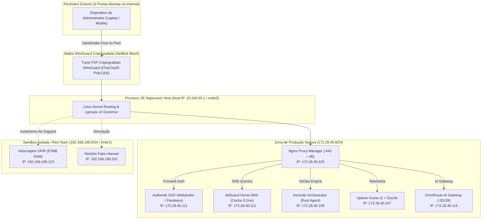

# 🏛️ Zero-Trust High-Density Homelab Infrastructure

[](https://lessa-github.github.io/homelab-zero-trust-infra/)
[](https://proxmox.com)
[](https://netbird.io)
[](https://lessa-github.github.io/gabriel-portfolio/)

Repositório oficial documentando a arquitetura de produção, automação, observabilidade e hardening do meu **Homelab Zero-Trust** construído sobre **Proxmox Virtual Environment (PVE)**.

Projetado para operar **24/7 com alta densidade de serviços (12 LXCs ativos simultaneamente em apenas 32 GB de RAM), consumo elétrico inferior a 25W e ZERO portas abertas na WAN**.

---

## 🧭 Linha do Tempo de Engenharia (2025 - Presente)

* **Janeiro/2025 a Agosto/2026 (Fase Escolar & Fundação Teórica):**
  Estudos de arquitetura de redes, dimensionamento de hardware (cálculos de TDP de 15W a 35W), matriz de densidade de memória e modelagem de topologia no Cisco Packet Tracer com sub-redes corporativas documentadas (`172.28.40.0/24`). Definição do princípio de banir port-forwarding na internet residencial.
* **Agosto/2026 (Formatura & Chegada do Hardware):**
  Fim das aulas no colégio; montagem e setup físico do host Proxmox VE 8, particionamento NVMe, bridges de rede `vmbr0` e `vmbr1`.
* **Setembro/2026 a Outubro/2026 (Mão na Massa Acelerada & Produção):**
  Implantação da malha NetBird WireGuard, AdGuard Home DNS com cache otimista (0.2ms), Nginx Proxy Manager com certificados Wildcard via DNS Challenge, autenticação Authentik SSO com Passkeys FIDO2 e migração para GitOps com Komodo Orchestrator.

---

## 📐 Topologia de Rede & Zonas de Confiança



---

## 📊 Matriz de Serviços em Produção (12 LXCs 24/7)

| CT ID | Hostname | IP Sintético | Função Principal | Footprint RAM | Stack Tecnológica |
| :---: | :--- | :---: | :--- | :---: | :--- |
| **103** | `nginx-proxy-manager` | `172.28.40.103` | Reverse Proxy TLS Wildcard + Forward-Auth | 180 MB | OpenResty, Nginx, Certbot |
| **104** | `vaultwarden` | `172.28.40.104` | Cofre de Senhas Criptografado | 45 MB | Rust Server, SQLite, WebSockets |
| **105** | `matrix-synapse` | `172.28.40.105` | Mensageria Federada E2EE + LiveKit WebRTC | 520 MB | Python Synapse, LiveKit Go |
| **106** | `homepage-dashboard` | `172.28.40.106` | Dashboard Central com Telemetria PVE | 110 MB | Next.js SSR, API Integrations |
| **107** | `uptime-kuma` | `172.28.40.107` | Monitoramento Contínuo (51 monitores) | 160 MB | Node.js, SQLite, Push Notifications |
| **108** | `dozzle-logs` | `172.28.40.108` | Agregação de Logs Read-Only & Beszel Hub | 95 MB | Go Binary, Beszel Hardware Telemetry |
| **109** | `komodo` | `172.28.40.109` | Orquestrador GitOps de Containers | 180 MB | Rust Core, Periphery Agent |
| **111** | `authentik-sso` | `172.28.40.111` | Provedor de Identidade, WebAuthn & OIDC | 980 MB | Python, PostgreSQL 16, Redis |
| **112** | `adguard-home` | `172.28.40.112` | DNS Resolver DoH (Cache de 0.2ms) | 48 MB | Go Static Binary, DoH Upstreams |
| **113** | `simplelogin-alias` | `172.28.40.113` | Gerador de Aliases Anti-Spam e Privacidade | 310 MB | Flask, PostgreSQL, Postfix Engine |
| **114** | `omniroute-ai` | `172.28.40.114` | Gateway de IA Multi-Provider & Compressão | 195 MB | TypeScript, Redis Cache |
| **115** | `ai-workspace` | `172.28.40.115` | Agente Hermes, MCP & SearXNG Privado | 850 MB | Python 3.11, Debian 12 LXC |

---

## 🔒 Princípios de Arquitetura & Hardening

1. **Zero Port Forwarding:** Nenhuma porta é exposta no roteador residencial para a internet. Todo tráfego administrativo ingressa por túneis P2P WireGuard criptografados ponto a ponto (NetBird).
2. **DNS Otimista com 0.2ms de Latência:** AdGuard Home configurado com `cache_optimistic: true`. Responde consultas de cache instantaneamente e revalida em background contra upstreams DoH seguros.
3. **Autenticação Biométrica WebAuthn (Passkeys):** Eliminação de senhas estáticas. Acesso aos painéis administrativos requer chave criptográfica FIDO2 registrada no Authentik SSO.
4. **GitOps Leve com Komodo:** Substituição de ferramentas pesadas de gerenciamento de containers por agentes em Rust consumindo menos de 20 MB por nó.
5. **Kernel Tuning de SRE:** Calibragem de `sysctl.conf` no host Linux com mitigação de bufferbloat, reaproveitamento de sockets TCP (`tcp_tw_reuse`) e governança de memória via cgroups v2.

---

## 🛠️ CLI Controller: `labctl.sh`

O repositório inclui o utilitário de administração com documentação integrada `--help`:

```bash
$ ./cli-tools/labctl.sh --help
===================================================================
  LABCTL - Zero-Trust Homelab Infrastructure CLI Controller v1.4
===================================================================
Usage: ./labctl.sh [COMMAND] [OPTIONS]

Commands:
  status                   Display status of all managed LXC containers and host load
  backup <target>          Execute automated backup with Zero-Knowledge encryption
  dns-health               Validate AdGuard Home cache latency and upstream resolution
  netbird-mesh             Audit active WireGuard peers and subnet routes
  tune-kernel              Apply sysctl performance tunings and verify cgroups v2

Options:
  -v, --verbose            Enable detailed debug output
  -s, --sanitized          Force JSON output with fully sanitized network addresses
  -h, --help               Show this help message and exit
```

---

## 🌐 Documentação Web Completa (Live Docsify)

Para explorar a documentação técnica com diagramas interativos, guias passo a passo e configurações declarativas, acesse o site oficial da documentação:

👉 **[https://lessa-github.github.io/homelab-zero-trust-infra/](https://lessa-github.github.io/homelab-zero-trust-infra/)**
