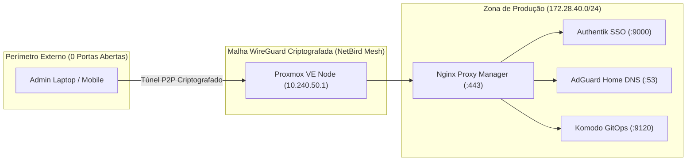

# 🏛️ Homelab Zero-Trust & Infraestrutura de Alta Densidade

Repositório oficial documentando a arquitetura de produção, automação e hardening do meu Homelab baseado em **Proxmox Virtual Environment (PVE)**.

Projetado para operar 24/7 com máxima eficiência energética, consumo inferior a 25W e **zero portas abertas na internet**.

---

## 🧭 Linha do Tempo do Projeto
* **Janeiro/2025 a Agosto/2026:** Planejamento teórico, dimensionamento de hardware, cálculos de TDP e simulações de redes no Cisco Packet Tracer durante o período escolar.
* **Agosto/2026:** Fim das aulas e formatura; início da execução prática no hardware físico.
* **Setembro/2026 a Outubro/2026:** Implantação de malha WireGuard, Authentik SSO com Passkeys, AdGuard DNS e orquestração GitOps.

---

## 📐 Topologia de Rede & Zonas de Confiança

