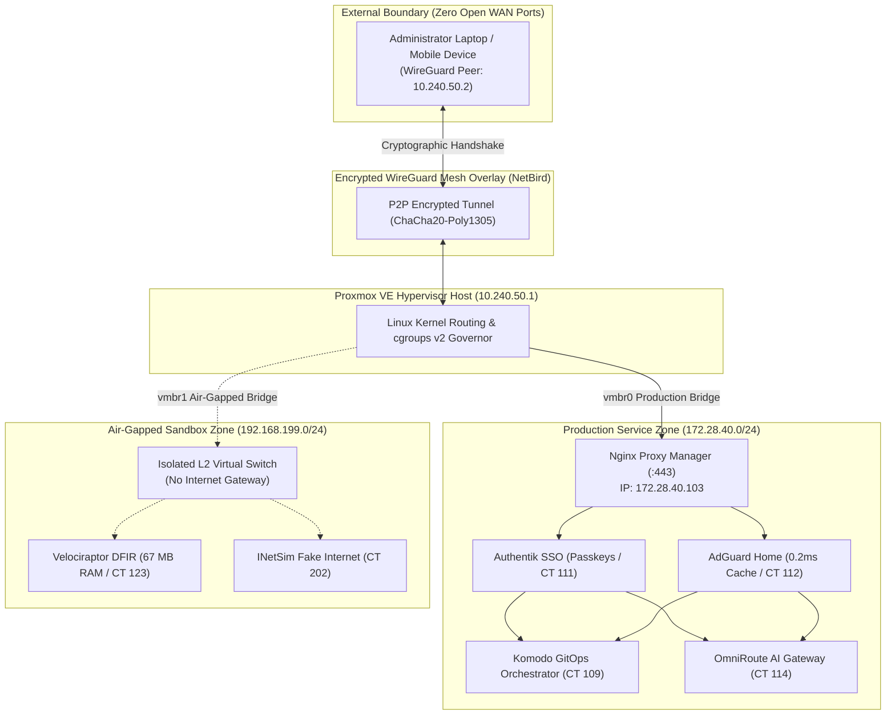

# 🏛️ Zero-Trust High-Density Homelab Infrastructure

[](https://lessa-github.github.io/homelab-zero-trust-infra/)
[](https://proxmox.com)
[](https://netbird.io)
[](https://lessa-github.github.io/gabriel-portfolio/)

Official repository documenting the production engineering, network architecture, automated orchestration, and SRE hardening of my **Zero-Trust Homelab Infrastructure** running on **Proxmox Virtual Environment (PVE)**.

Designed to operate **24/7 with high service density (12 persistent LXCs running concurrently in only 32 GB of RAM), under 25W power draw, and ZERO open WAN ports**.

---

## 🧭 Engineering Timeline (2025 – Present)

* **January/2025 to August/2026 (College Coursework & Theoretical Foundation):**
  Network architecture studies, hardware capacity planning (TDP targets of 15W to 35W, RAM allocation matrix), and topology simulations in Cisco Packet Tracer with documented corporate subnets (`172.28.40.0/24`). Established the strict architectural rule banning residential WAN port-forwarding.
* **August/2026 (Completed College Classes & Hardware Deployment):**
  Classes concluded; physical host assembly and Proxmox VE 8 initialization, NVMe ZFS storage partitioning, and Linux multi-bridge configuration (`vmbr0` and `vmbr1`).
* **September/2026 to October/2026 (Full Hands-on & Production Hardening):**
  NetBird WireGuard mesh deployment, AdGuard Home DNS with optimistic caching (0.2ms latency), Nginx Proxy Manager wildcard SSL via DNS Challenge, Authentik SSO with FIDO2 / WebAuthn passkeys, and declarative container GitOps migration with Komodo Orchestrator.

---

## 📐 Zero-Trust Network Topology



---

## 📊 24/7 Production Services Matrix (12 LXCs)

| CT ID | Hostname | Documentation IP | RAM Allocation | Primary Role | Technology Stack |
| :---: | :--- | :---: | :---: | :--- | :--- |
| **103** | `nginx-proxy-manager` | `172.28.40.103` | 180 MB | Wildcard SSL Reverse Proxy & Forward-Auth | OpenResty, Certbot DNS-01 |
| **104** | `vaultwarden` | `172.28.40.104` | 45 MB | Encrypted Password Vault | Rust Server, SQLite, WebSockets |
| **105** | `matrix-synapse` | `172.28.40.105` | 520 MB | Federated E2EE Messaging & LiveKit WebRTC | Python Synapse, LiveKit Go |
| **106** | `homepage-dashboard` | `172.28.40.106` | 110 MB | Real-time Hypervisor Telemetry Portal | Next.js SSR, Proxmox API |
| **107** | `uptime-kuma` | `172.28.40.107` | 160 MB | Continuous Health Monitoring (51 Monitors) | Node.js, SQLite, Push Notifications |
| **108** | `dozzle-logs` | `172.28.40.108` | 95 MB | Read-Only Streaming Logs & Beszel Hub | Go Binary, Beszel Telemetry |
| **109** | `komodo` | `172.28.40.109` | 180 MB | Declarative GitOps Container Orchestration | Rust Core, Periphery Agent |
| **111** | `authentik-sso` | `172.28.40.111` | 980 MB | Central Identity Provider, Passkeys & OIDC | Python, PostgreSQL 16, Redis |
| **112** | `adguard-home` | `172.28.40.112` | 48 MB | Hardened DNS Resolver (0.2ms Cache) | Go Static Binary, DoH Upstreams |
| **113** | `simplelogin-alias` | `172.28.40.113` | 310 MB | Anti-Spam Email Aliasing & Forwarding | Flask, PostgreSQL, Postfix Engine |
| **114** | `omniroute-ai` | `172.28.40.114` | 195 MB | Multi-Provider AI API Gateway & Compression | TypeScript, Redis Cache |
| **115** | `ai-workspace` | `172.28.40.115` | 850 MB | Hermes Autonomous Agent, MCP & SearXNG | Python 3.11, Debian 12 LXC |

---

## 🛠️ Infrastructure CLI Controller: labctl.sh

```text
$ ./cli-tools/labctl.sh --help
===================================================================
  LABCTL - Zero-Trust Homelab Infrastructure CLI Controller v1.4
===================================================================
Usage: ./labctl.sh [COMMAND] [OPTIONS]

Commands:
  status                   Display status of all managed LXC containers and host load
  backup <target>          Execute automated backup with Zero-Knowledge encryption
  dns-health               Validate AdGuard Home cache latency and upstream resolution
  netbird-mesh             Audit active WireGuard peers and subnet routes
  tune-kernel              Apply sysctl performance tunings and verify cgroups v2

Options:
  -v, --verbose            Enable detailed debug output
  -s, --sanitized          Force JSON output with fully sanitized network addresses
  -h, --help               Show this help message and exit
```

---

## 🌐 Live Technical Documentation

Explore the complete single-page interactive whitepaper with smooth section scrolling:

👉 **[https://lessa-github.github.io/homelab-zero-trust-infra/](https://lessa-github.github.io/homelab-zero-trust-infra/)**
