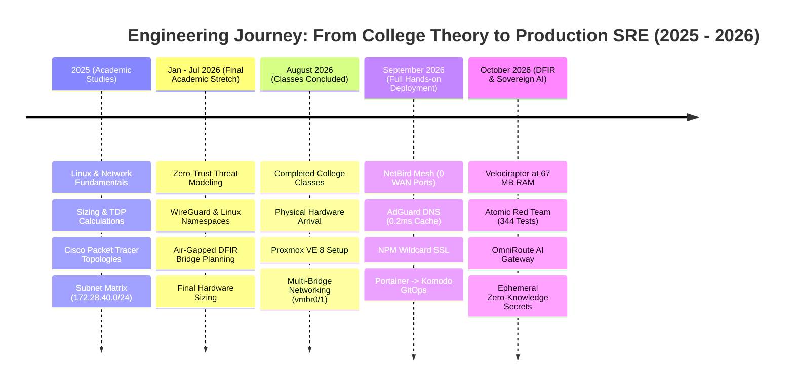
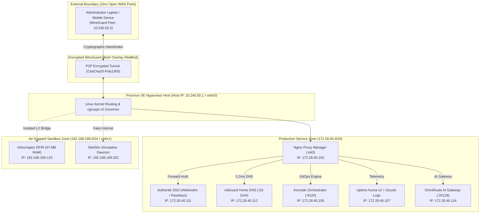
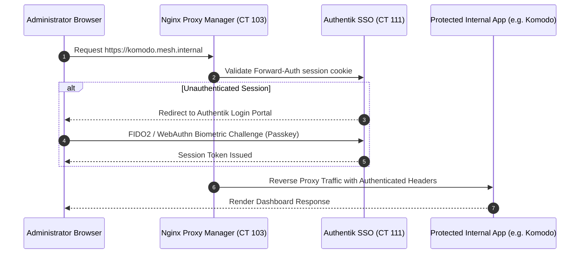

# 🏛️ Zero-Trust High-Density Homelab Infrastructure

> **Author:** Gabriel Santa Rosa Lessa  
> **Timeline:** 2025 – Present (College Studies 2025 - Aug/2026 · Intensive Hands-on Aug/2026 - Present)  
> **Hypervisor:** Proxmox VE 8.x (Custom Linux Kernel, cgroups v2 Governor)  
> **Architecture Core:** Zero WAN Port-Forwarding · P2P WireGuard Mesh · Centralized Biometric SSO

---

## 📋 Executive Summary

This repository documents the production engineering, network architecture, automation, and SRE hardening of my **Zero-Trust Homelab Infrastructure** running on **Proxmox Virtual Environment (PVE)**.

Designed to solve a real-world enterprise engineering constraint:  
**How to operate 12 critical production services 24/7 in high availability on a single low-power host with only 32 GB of RAM and under 25W of power draw, while enforcing strict Zero-Trust isolation?**

### Key Engineering Achievements:
* **Zero WAN Port-Forwarding:** No ports are open on the residential router. 100% of administrative and service ingress is routed over an encrypted peer-to-peer WireGuard mesh overlay (NetBird).
* **0.2ms DNS Cache Latency:** AdGuard Home with optimistic caching (`cache_optimistic: true`) and redundant upstream DNS-over-HTTPS (DoH) providers.
* **Biometric Identity Federation:** Elimination of static passwords via Authentik SSO with Forward-Auth and FIDO2 / WebAuthn passkeys.
* **Lightweight Rust GitOps:** Declarative container orchestration powered by Komodo Periphery Agent (<18 MB RAM per agent).
* **Memory Contention Defense:** Linux kernel tuning via `sysctl.conf` and cgroups v2 resource quotas to eliminate telemetry feedback loops and OOM killer thrashing.

---

## 🧭 Engineering Timeline (2025 – Present)



### The Value of 19 Months of Planning (Jan/2025 - Aug/2026)
No infrastructure project succeeds by buying hardware blindly. The architecture was designed during college studies before writing a single configuration line:
1. **Capacity Planning:** Calculating RAM budgets (32 GB DDR4 allocation matrix) and thermal design power (TDP target of 15W - 35W) for 24/7 silent operation.
2. **Subnet Modeling:** Simulating VLANs and routing matrices in Cisco Packet Tracer with private documentation subnets (`172.28.40.0/24`).
3. **Zero-Trust Rule of Law:** Enforcing the architectural rule that opening WAN ports creates unacceptable attack surface.

---

## 📐 Zero-Trust Network Topology



### Documented Subnet Allocation

| Subnet CIDR | Functional Zone | Isolation & Security Policy |
| :--- | :--- | :--- |
| **`172.28.40.0/24`** | Production Services (`vmbr0`) | Internal production services; ingress exclusively via authenticated WireGuard overlay. |
| **`192.168.199.0/24`** | Air-Gapped Sandbox (`vmbr1`) | Completely air-gapped; no default gateway or internet route; traffic trapped at Layer 2. |
| **`10.240.50.0/24`** | NetBird Mesh Overlay | Encrypted point-to-point tunnels with Ed25519 peer verification. |

---

## 📊 24/7 Production Services Matrix (12 LXCs)

All persistent services run inside **Debian 12 unprivileged LXC containers** (`unprivileged: 1`) on dedicated storage volumes:

| CT ID | Hostname | Documentation IP | RAM Allocation | Primary Role | Technology Stack |
| :---: | :--- | :---: | :---: | :--- | :--- |
| **103** | `nginx-proxy-manager` | `172.28.40.103` | 180 MB | Wildcard SSL Reverse Proxy & Forward-Auth | OpenResty, Certbot DNS-01 |
| **104** | `vaultwarden` | `172.28.40.104` | 45 MB | Encrypted Password Vault | Rust Server, SQLite, WebSockets |
| **105** | `matrix-synapse` | `172.28.40.105` | 520 MB | Federated E2EE Messaging & LiveKit WebRTC | Python Synapse, LiveKit Go |
| **106** | `homepage-dashboard` | `172.28.40.106` | 110 MB | Real-time Hypervisor Telemetry Portal | Next.js SSR, Proxmox API |
| **107** | `uptime-kuma` | `172.28.40.107` | 160 MB | Continuous Health Monitoring (51 Monitors) | Node.js, SQLite, Push Notifications |
| **108** | `dozzle-logs` | `172.28.40.108` | 95 MB | Read-Only Streaming Logs & Beszel Hub | Go Binary, Beszel Telemetry |
| **109** | `komodo` | `172.28.40.109` | 180 MB | Declarative GitOps Container Orchestration | Rust Core, Periphery Agent |
| **111** | `authentik-sso` | `172.28.40.111` | 980 MB | Central Identity Provider, Passkeys & OIDC | Python, PostgreSQL 16, Redis |
| **112** | `adguard-home` | `172.28.40.112` | 48 MB | Hardened DNS Resolver (0.2ms Cache) | Go Static Binary, DoH Upstreams |
| **113** | `simplelogin-alias` | `172.28.40.113` | 310 MB | Anti-Spam Email Aliasing & Forwarding | Flask, PostgreSQL, Postfix Engine |
| **114** | `omniroute-ai` | `172.28.40.114` | 195 MB | Multi-Provider AI API Gateway & Compression | TypeScript, Redis Cache |
| **115** | `ai-workspace` | `172.28.40.115` | 850 MB | Hermes Autonomous Agent, MCP & SearXNG | Python 3.11, Debian 12 LXC |

---

## 🛡️ Security Hardening & Passkeys SSO



### Defense-in-Depth Highlights:
1. **FIDO2 / WebAuthn Passkeys:** Elimination of shared passwords. Access to sensitive administrative portals requires biometric authentication (TouchID, Windows Hello, or physical security key).
2. **Wildcard TLS via DNS-01 Challenge:** Let's Encrypt certificates are acquired through automated TXT record creation on the DNS provider. Zero HTTP ports are exposed to the public internet for certificate renewals.
3. **HSTS Strict Transport:** All internal hostnames enforce `Strict-Transport-Security: max-age=31536000; includeSubDomains`.

---

## ⚙️ SRE Telemetry & Kernel Tuning

To prevent **telemetry feedback loops** where observability agents consume more compute than the actual workloads, we established a frugal SRE baseline:

### 1. Beszel Hub & Agent (CT 108)
* Lightweight Go telemetry agent consuming **<15 MB RAM per node**.
* Hardware telemetry tracking CPU throttling, RAM pressure, network interface I/O, and NVMe S.M.A.R.T. health without polling bloat.

### 2. Linux Kernel Parameters (`/etc/sysctl.conf`)

```ini
# Mitigate socket descriptor exhaustion under high container density
net.core.somaxconn = 65535
net.ipv4.tcp_max_syn_backlog = 8192

# Enable rapid reuse of TCP sockets in TIME_WAIT state
net.ipv4.tcp_tw_reuse = 1

# Virtual memory governance: avoid aggressive swapping
vm.swappiness = 10
vm.dirty_ratio = 15
vm.dirty_background_ratio = 5

# Prevent ARP flux issues across multiple Linux bridge interfaces
net.ipv4.conf.all.arp_ignore = 1
net.ipv4.conf.all.arp_announce = 2
```

---

## 🛠️ Infrastructure CLI Controller: labctl.sh

The infrastructure includes an automated CLI controller with formatted `--help` output:

```text
$ ./cli-tools/labctl.sh --help
===================================================================
  LABCTL - Zero-Trust Homelab Infrastructure CLI Controller v1.4
===================================================================
Usage: ./labctl.sh [COMMAND] [OPTIONS]

Commands:
  status                   Display status of all managed LXC containers and host load
  backup <target>          Execute automated backup with Zero-Knowledge encryption
  dns-health               Validate AdGuard Home cache latency and upstream resolution
  netbird-mesh             Audit active WireGuard peers and subnet routes
  tune-kernel              Apply sysctl performance tunings and verify cgroups v2

Options:
  -v, --verbose            Enable detailed debug output
  -s, --sanitized          Force JSON output with fully sanitized network addresses
  -h, --help               Show this help message and exit
```

---

## 🔗 Connected Repositories & Live Portals

* 🛡️ **[Cyber DFIR Training Lab](https://lessa-github.github.io/cyber-dfir-training-lab/)** — Digital Forensics, Velociraptor (67MB RAM) & Purple Teaming.
* 🧠 **[Sovereign AI Workspace](https://lessa-github.github.io/sovereign-ai-workspace/)** — Multi-Provider Gateway, Caveman Compression & Private Search.
* ⚰️ **[Homelab Graveyard & Lessons Learned](https://lessa-github.github.io/homelab-graveyard-and-lessons-learned/)** — SRE Case Studies on Decommissioning Bloatware.
* 🔒 **[Zero-Knowledge Secret Framework](https://github.com/Lessa-github/zero-knowledge-secret-framework)** — Ephemeral Memory Secret Injection Engine (Private).
