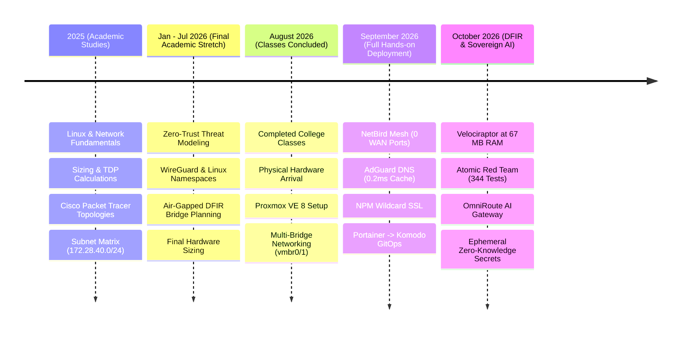
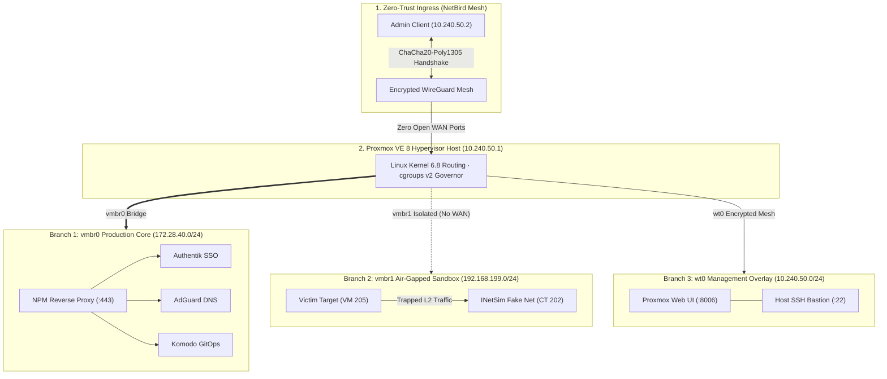
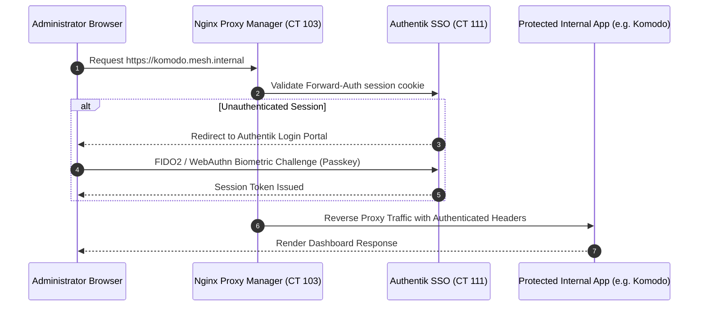

# 🏛️ Zero-Trust High-Density Homelab Infrastructure

> **Author:** Gabriel Santa Rosa Lessa  
> **Timeline:** 2025 – Present (College Studies 2025 - Aug/2026 · Intensive Hands-on Aug/2026 - Present)  
> **Hypervisor:** Proxmox VE 8.x (Custom Linux Kernel, cgroups v2 Governor)  
> **Architecture Core:** Zero WAN Port-Forwarding · P2P WireGuard Mesh · Centralized Biometric SSO

---

## 📋 Executive Summary :id=executive-summary

This repository documents the production engineering, network architecture, automation, and SRE hardening of my **Zero-Trust Homelab Infrastructure** running on **Proxmox Virtual Environment (PVE)**.

Designed to solve a real-world enterprise engineering constraint:  
**How to operate 12 critical production services 24/7 in high availability on a single low-power host with only 32 GB of RAM and under 25W of power draw, while enforcing strict Zero-Trust isolation?**

### Key Engineering Achievements:
* **Zero WAN Port-Forwarding:** No ports are open on the residential router. 100% of administrative and service ingress is routed over an encrypted peer-to-peer WireGuard mesh overlay (NetBird).
* **0.2ms DNS Cache Latency:** AdGuard Home with optimistic caching (`cache_optimistic: true`) and redundant upstream DNS-over-HTTPS (DoH) providers.
* **Biometric Identity Federation:** Elimination of static passwords via Authentik SSO with Forward-Auth and FIDO2 / WebAuthn passkeys.
* **Lightweight Rust GitOps:** Declarative container orchestration powered by Komodo Periphery Agent (<18 MB RAM per agent).
* **Memory Contention Defense:** Linux kernel tuning via `sysctl.conf` and cgroups v2 resource quotas to eliminate telemetry feedback loops and OOM killer thrashing.

---

## 🧭 Engineering Timeline (2025 – Present) :id=engineering-timeline

<p align="center" style="font-weight: 600; color: #38bdf8; font-size: 1.05rem; margin-bottom: 0.5rem;">
  🎯 Engineering Journey: From College Theory to Production SRE (2025 – 2026)
</p>



### The Value of 19 Months of Planning (Jan/2025 - Aug/2026)
No infrastructure project succeeds by buying hardware blindly. The architecture was designed during college studies before writing a single configuration line:
1. **Capacity Planning:** Calculating RAM budgets (32 GB DDR4 allocation matrix) and thermal design power (TDP target of 15W - 35W) for 24/7 silent operation.
2. **Subnet Modeling:** Simulating VLANs and routing matrices in Cisco Packet Tracer with private documentation subnets (`172.28.40.0/24`).
3. **Zero-Trust Rule of Law:** Enforcing the architectural rule that opening WAN ports creates unacceptable attack surface.

---

## 📐 Zero-Trust Network Topology :id=network-topology



### Documented Subnet Allocation

| Subnet CIDR | Functional Zone | Isolation & Security Policy |
| :--- | :--- | :--- |
| **`172.28.40.0/24`** | Production Services (`vmbr0`) | Internal production services; ingress exclusively via authenticated WireGuard overlay. |
| **`192.168.199.0/24`** | Air-Gapped Sandbox (`vmbr1`) | Completely air-gapped; no default gateway or internet route; traffic trapped at Layer 2. |
| **`10.240.50.0/24`** | NetBird Mesh Overlay | Encrypted point-to-point tunnels with Ed25519 peer verification. |

---

## 📊 24/7 Production Services Matrix (12 LXCs) :id=services-matrix

All persistent services run inside **Debian 12 unprivileged LXC containers** (`unprivileged: 1`) on dedicated storage volumes:

| CT ID | Hostname | Documentation IP | RAM Allocation | Primary Role | Technology Stack |
| :---: | :--- | :---: | :---: | :--- | :--- |
| **103** | `nginx-proxy-manager` | `172.28.40.103` | 180 MB | Wildcard SSL Reverse Proxy & Forward-Auth | OpenResty, Certbot DNS-01 |
| **104** | `vaultwarden` | `172.28.40.104` | 45 MB | Encrypted Password Vault | Rust Server, SQLite, WebSockets |
| **105** | `matrix-synapse` | `172.28.40.105` | 520 MB | Federated E2EE Messaging & LiveKit WebRTC | Python Synapse, LiveKit Go |
| **106** | `homepage-dashboard` | `172.28.40.106` | 110 MB | Real-time Hypervisor Telemetry Portal | Next.js SSR, Proxmox API |
| **107** | `uptime-kuma` | `172.28.40.107` | 160 MB | Continuous Health Monitoring (51 Monitors) | Node.js, SQLite, Push Notifications |
| **108** | `dozzle-logs` | `172.28.40.108` | 95 MB | Read-Only Streaming Logs & Beszel Hub | Go Binary, Beszel Telemetry |
| **109** | `komodo` | `172.28.40.109` | 180 MB | Declarative GitOps Container Orchestration | Rust Core, Periphery Agent |
| **111** | `authentik-sso` | `172.28.40.111` | 980 MB | Central Identity Provider, Passkeys & OIDC | Python, PostgreSQL 16, Redis |
| **112** | `adguard-home` | `172.28.40.112` | 48 MB | Hardened DNS Resolver (0.2ms Cache) | Go Static Binary, DoH Upstreams |
| **113** | `simplelogin-alias` | `172.28.40.113` | 310 MB | Anti-Spam Email Aliasing & Forwarding | Flask, PostgreSQL, Postfix Engine |
| **114** | `omniroute-ai` | `172.28.40.114` | 195 MB | Multi-Provider AI API Gateway & Compression | TypeScript, Redis Cache |
| **115** | `ai-workspace` | `172.28.40.115` | 850 MB | Hermes Autonomous Agent, MCP & SearXNG | Python 3.11, Debian 12 LXC |

---

## 🛡️ Security Hardening & Passkeys SSO :id=security-hardening



### Defense-in-Depth Highlights:
1. **FIDO2 / WebAuthn Passkeys:** Elimination of shared passwords. Access to sensitive administrative portals requires biometric authentication (TouchID, Windows Hello, or physical security key).
2. **Wildcard TLS via DNS-01 Challenge:** Let's Encrypt certificates are acquired through automated TXT record creation on the DNS provider. Zero HTTP ports are exposed to the public internet for certificate renewals.
3. **HSTS Strict Transport:** All internal hostnames enforce `Strict-Transport-Security: max-age=31536000; includeSubDomains`.

---

## ⚙️ SRE Telemetry & Kernel Tuning :id=sre-telemetry

To prevent **telemetry feedback loops** where observability agents consume more compute than the actual workloads, we established a frugal SRE baseline:

### 1. Beszel Hub & Agent (CT 108)
* Lightweight Go telemetry agent consuming **<15 MB RAM per node**.
* Hardware telemetry tracking CPU throttling, RAM pressure, network interface I/O, and NVMe S.M.A.R.T. health without polling bloat.

### 2. Linux Kernel Parameters (`/etc/sysctl.conf`)

```ini
# Mitigate socket descriptor exhaustion under high container density
net.core.somaxconn = 65535
net.ipv4.tcp_max_syn_backlog = 8192

# Enable rapid reuse of TCP sockets in TIME_WAIT state
net.ipv4.tcp_tw_reuse = 1

# Virtual memory governance: avoid aggressive swapping
vm.swappiness = 10
vm.dirty_ratio = 15
vm.dirty_background_ratio = 5

# Prevent ARP flux issues across multiple Linux bridge interfaces
net.ipv4.conf.all.arp_ignore = 1
net.ipv4.conf.all.arp_announce = 2
```

---

## 🛠️ Infrastructure CLI Controller: labctl.sh :id=cli-controller

The infrastructure includes an automated CLI controller with formatted `--help` output:

```text
$ ./cli-tools/labctl.sh --help
===================================================================
  LABCTL - Zero-Trust Homelab Infrastructure CLI Controller v1.4
===================================================================
Usage: ./labctl.sh [COMMAND] [OPTIONS]

Commands:
  status                   Display status of all managed LXC containers and host load
  backup <target>          Execute automated backup with Zero-Knowledge encryption
  dns-health               Validate AdGuard Home cache latency and upstream resolution
  netbird-mesh             Audit active WireGuard peers and subnet routes
  tune-kernel              Apply sysctl performance tunings and verify cgroups v2

Options:
  -v, --verbose            Enable detailed debug output
  -s, --sanitized          Force JSON output with fully sanitized network addresses
  -h, --help               Show this help message and exit
```

---

## 📦 Vetted Open-Source Upstream Stacks :id=vetted-repositories

To maintain a zero-compromise security posture and adhere to our **Frugal SRE** principles, every piece of software evaluated across the homelab undergoes a rigorous **AppSec Supply Chain Audit** prior to deployment in unprivileged LXC containers or virtualized sandbox environments.

This curated directory compiles the complete catalog of open-source projects, tools, and Model Context Protocol (MCP) servers across four operational lifecycle stages:

---

### 🟢 1. Active Production Stacks (Currently Running 24/7)

The core operational services powering the zero-trust homelab and cyber defense lab on the Proxmox VE host:

| Project & Repository | Target Role | License | Architectural Role & AppSec Audit Findings |
| :--- | :--- | :--- | :--- |
| **[NetBird](https://github.com/netbirdio/netbird)** | Mesh Network (`PVE Host`) | `BSD-3-Clause` | Encrypted WireGuard P2P overlay with Ed25519 peer verification; eliminates residential port-forwarding. |
| **[OPNsense Core](https://github.com/opnsense/core)** | Perimeter Routing (`PVE vmbr0/1`) | `BSD-2-Clause` | Virtualized FreeBSD stateful inspection, strict inter-VLAN zoning, and air-gapped sandbox network isolation. |
| **[Nginx Proxy Manager](https://github.com/NginxProxyManager/nginx-proxy-manager)** | Reverse Proxy (`CT 103`) | `MIT` | Dynamic HTTP/2 TLS termination, WebSocket streaming, and automated DuckDNS wildcard SSL DNS-challenge. |
| **[AdGuard Home](https://github.com/AdguardTeam/AdGuardHome)** | DNS Sinkhole (`CT 112`) | `GPL-3.0` | 0.2ms cached DNS queries (`cache_optimistic: true`); redundant upstream DNS-over-HTTPS (DoH) failover. |
| **[Authentik](https://github.com/goauthentik/authentik)** | Identity & SSO (`CT 111`) | `GPL-3.0` | Centralized Forward-Auth gateway and OIDC provider enforcing hardware WebAuthn / FIDO2 Passkeys. |
| **[Komodo Orchestrator](https://github.com/mbecker20/komodo)** | GitOps Engine (`CT 109`) | `GPL-3.0` | Declarative Rust-based container orchestrator; Periphery build agent runs in <18 MB RAM. |
| **[Vaultwarden](https://github.com/dani-garcia/vaultwarden)** | Secrets Vault (`CT 108`) | `AGPL-3.0` | Frugal Rust implementation of Bitwarden API with SQLite; zero Java/Node heap overhead (<30 MB RAM). |
| **[SimpleLogin](https://github.com/simple-login/app)** | Email Privacy (`CT 110`) | `MIT` | PGP-encrypted disposable email aliasing suite preventing credential correlation and marketing tracking. |
| **[Beszel](https://github.com/henrygd/beszel)** | Hardware Telemetry (`CT 116`) | `MIT` | Go-based lightweight resource telemetry hub; S.M.A.R.T. disk monitoring with zero JVM telemetry loops. |
| **[Dozzle](https://github.com/amir20/dozzle)** | Log Streaming (`CT 113`) | `MIT` | Real-time container log aggregator via non-blocking WebSockets; zero disk-indexing write tax on SSDs. |
| **[Uptime Kuma](https://github.com/louislam/uptime-kuma)** | Availability Monitor (`CT 107`) | `MIT` | SQLite-backed synthetic health monitoring; automated alert webhooks on service degradation. |
| **[Velociraptor](https://github.com/Velocidex/velociraptor)** | Endpoint DFIR (`CT 123`) | `AGPL-3.0` | Compiled static Go binary running in 67 MB RAM; on-demand VQL memory queries vs 6 GB SIEM clusters. |
| **[OpenCTI](https://github.com/OpenCTI-Platform/opencti)** | Threat Intelligence (`CT 120`) | `Apache-2.0` | Structured STIX 2.1 threat intelligence platform with lean Redis caching and MITRE ATT&CK ontology. |
| **[Atomic Red Team](https://github.com/redcanaryco/atomic-red-team)** | Purple Team (`Sandbox`) | `MIT` | 344 mapped MITRE ATT&CK atomic tests with automated post-execution telemetry cleanup. |
| **[INetSim](https://github.com/inetsim/inetsim)** | Malware Analysis (`CT 202`) | `GPL-2.0` | Simulated DNS/HTTP/SMTP daemons for trapping rogue malware traffic inside isolated Layer 2 `vmbr1`. |
| **[SearXNG](https://github.com/searxng/searxng)** | Private Search (`CT 114`) | `AGPL-3.0` | Zero-telemetry metasearch engine serving contextual JSON search API to autonomous AI agents. |
| **[Ollama](https://github.com/ollama/ollama)** | Local LLM Engine (`CT 115`) | `MIT` | Lightweight local GGUF model runner supporting air-gapped sovereign inference fallback. |
| **[Memos](https://github.com/usememos/memos)** | Knowledge Snippets (`CT 118`) | `MIT` | Privacy-first, lightweight Markdown card database for architecture notes and rapid scratchpads. |

---

### ⚰️ 2. Audited & Decommissioned Stacks (Retired with Lessons Learned)

Software platforms that were systematically tested, benchmarked, and intentionally decommissioned due to excessive hardware taxation, architectural bloat, or security vulnerabilities:

| Retired Platform & Repo | Former Role | Replacement | Primary SRE & AppSec Rationale |
| :--- | :--- | :--- | :--- |
| **[Portainer](https://github.com/portainer/portainer)** | Container Management | Komodo GitOps | Heavy Node/Go web stack; lack of declarative GitOps auto-sync in community edition; high idle memory. |
| **[n8n](https://github.com/n8n-io/n8n)** | Workflow Automation | Hermes Agent + MCP | Heavy Node.js monolith consuming 1,450 MB RAM with continuous background polling loops. |
| **[Asuri / Azuri](https://github.com/asuri-dev/asuri)** | SAST Code Scanner | Static SAST Pipeline | Disqualified during AppSec code audit due to unescaped `os.system()` arbitrary command injection flaws. |
| **[Wazuh SIEM](https://github.com/wazuh/wazuh)** + **[OpenSearch](https://github.com/opensearch-project/OpenSearch)** | SIEM / XDR | Velociraptor VQL | Over 6 GB of RAM consumed by Java Virtual Machine (JVM) heaps with rapid NVMe endurance degradation. |
| **[Homepage](https://github.com/gethomepage/homepage)** | Service Dashboard | Direct DNS Rewrites | Continuous client-side widget polling generated unnecessary API noise and CPU wakeups on idle containers. |
| **[Matrix Synapse](https://github.com/element-hq/synapse)** + **[Element](https://github.com/element-hq/element-web)** | Chat Server | Native NetBird Channels | Python/Twisted homeserver consumed >500 MB RAM for single-user operation; complex federation overhead. |
| **[Kasm Workspaces](https://github.com/kasmtech/workspaces-core)** | Container Streaming | Dedicated KVM Guests | Required privileged containers (`nesting=1`, DinD, FUSE) that compromised hypervisor isolation boundaries. |
| **[Immich](https://github.com/immich-app/immich)** | Photo Management | External Cold Storage | Intensive machine learning face-recognition pipelines overwhelmed CPU quotas on a 250 GB SSD baseline. |

---

### 🚀 3. Future Hardware & Scaling Roadmap (Next-Machine Target Stacks)

Enterprise software stacks slated for deployment upon hardware expansion (e.g., secondary multi-NIC node, dedicated NAS storage, or Alienware RTX 3070 Ti GPU server):

| Project & Repository | Target Domain | Minimum Hardware Requirement | Intended Architectural Purpose |
| :--- | :--- | :--- | :--- |
| **[Suricata](https://github.com/OISF/suricata)** | Network NDR / IDS / IPS | Dedicated Multi-NIC Hardware | Multi-gigabit deep packet inspection and network threat detection tapping mirror ports. |
| **[Zeek NSM](https://github.com/zeek/zeek)** | Behavioral Network Telemetry | 8 GB RAM + Dedicated SSD Volume | Compact protocol-level transaction logging (DNS, TLS, HTTP) for forensic hunting. |
| **[TheHive](https://github.com/TheHive-Project/TheHive)** + **[Cortex](https://github.com/TheHive-Project/Cortex)** | SOC Case Management | 8 GB RAM (Elasticsearch Cluster) | Collaborative incident response workflow orchestration and automated observable enrichment. |
| **[MISP](https://github.com/MISP/MISP)** | Threat Intelligence Sharing | 4 GB RAM + MySQL / Redis | Automated indicator of compromise (IOC) correlation and threat feed exchange with OpenCTI. |
| **[Caldera](https://github.com/mitre/caldera)** | Automated Adversary Emulation | 4 vCPU + 8 GB RAM | MITRE ATT&CK automated adversary emulation plugins for continuous detection validation. |
| **[Ghidra Server](https://github.com/NationalSecurityAgency/ghidra)** | Collaborative Reverse Engineering | 4 GB RAM (Shared Multi-User) | NSA reverse engineering suite configured with centralized multi-analyst project repository. |
| **[GNS3 Server](https://github.com/GNS3/gns3-server)** | Enterprise Network Virtualization | 16 GB RAM + KVM Hardware Pass | Virtualized Cisco IOS-XE, Arista EOS, and Juniper Junos enterprise topology simulation. |
| **[vLLM](https://github.com/vllm-project/vllm)** / **[SGLang](https://github.com/sgl-project/sglang)** | High-Throughput LLM Serving | NVIDIA GPU (RTX 3070 Ti 8GB VRAM) | PagedAttention inference server exposing OpenAI-compatible endpoints with FP16/AWQ quantization. |
| **[Qdrant](https://github.com/qdrant/qdrant)** | Vector Database | 4 GB RAM + AVX2 Support | High-performance Rust vector search engine for autonomous AI long-term semantic memory retrieval. |
| **[RustDesk Server](https://github.com/rustdesk/rustdesk-server)** | Sovereign Remote Desktop | 1 vCPU · 512 MB RAM | Self-hosted encrypted relay and rendezvous server for out-of-band graphical management. |
| **[ownCloud Infinite Scale](https://github.com/owncloud/ocis)** | Sovereign Cloud Storage | Dedicated ZFS Pool / NAS | Cloud-native Go microservices file sync and sharing without PHP or external database dependencies. |
| **[Whonix](https://github.com/Whonix/Whonix)** | Anonymous OSINT Lab | 4 GB RAM (Gateway + Workstation) | Dual-VM isolated OSINT investigation environment routing 100% of traffic through the Tor network. |

---

### 🔌 4. Model Context Protocol (MCP) Ecosystem & Agent Tooling

Standardized tool servers and agent harnesses implementing Anthropic's **Model Context Protocol (MCP)**, connecting AI models to our local homelab infrastructure, telemetry pipelines, and development environments:

| MCP Server / Harness | Source & Spec | Host Environment | Core Agent Capability & Tools Provided |
| :--- | :--- | :--- | :--- |
| **[MCP Specification](https://github.com/modelcontextprotocol/specification)** | Open Standard | Global Standard | Standardized protocol enabling secure tool invocation and resource discovery across LLMs. |
| **[Playwright MCP](https://github.com/executeautomation/mcp-playwright)** | NPM / Local Harness | Node.js Runtime | Headless browser automation, visual screenshots, DOM snapshots, and E2E evaluation. |
| **[Chrome DevTools MCP](https://github.com/GoogleChrome/chrome-devtools-mcp)** | Google Official | Chrome / Chromium | Live DOM inspection, CSS box-model auditing, console telemetry, and network request analysis. |
| **[Memory Graph MCP](https://github.com/modelcontextprotocol/servers/tree/main/src/memory)** | Reference Server | Local SQLite / JSON | Persistent knowledge-graph memory storing entities, relations, and observations across sessions. |
| **[Filesystem MCP](https://github.com/modelcontextprotocol/servers/tree/main/src/filesystem)** | Reference Server | Local Sandbox | Granular, path-restricted filesystem read/write operations for autonomous agent pair-programming. |
| **[Fetch MCP](https://github.com/modelcontextprotocol/servers/tree/main/src/fetch)** | Reference Server | Node.js / Python | Fast HTTP resource retrieval and HTML-to-Markdown conversion without full browser overhead. |
| **[Docker MCP](https://github.com/ckreiling/mcp-server-docker)** | Community Server | Docker Engine Socket | Real-time container state inspection, restart actions, and isolated log retrieval via MCP. |
| **[SQLite MCP](https://github.com/modelcontextprotocol/servers/tree/main/src/sqlite)** | Reference Server | Local SQLite Engine | Zero-latency local database schema querying, SQL statement execution, and data validation. |
| **[Git & GitHub MCP](https://github.com/modelcontextprotocol/servers/tree/main/src/github)** | Reference Server | Local Git / API | Automated branch management, commit auditing, repository exploration, and issue tracking. |
| **[Hermes Agent Engine](https://github.com/NousResearch/Hermes-Function-Calling)** | Nous Research | Debian 12 LXC (`CT 115`) | Autonomous agent execution harness supporting multi-step tool calling and local shell execution. |

---

## 🔗 Connected Portals & Repositories :id=connected-portals

* 🛡️ **[Cyber DFIR Training Lab](https://lessa-github.github.io/cyber-dfir-training-lab/)** — Digital Forensics, Velociraptor (67MB RAM) & Purple Teaming.
* 🧠 **[Sovereign AI Workspace](https://lessa-github.github.io/sovereign-ai-workspace/)** — Multi-Provider Gateway, Caveman Compression & Private Search.
* ⚰️ **[Homelab Graveyard & Lessons Learned](https://lessa-github.github.io/homelab-graveyard-and-lessons-learned/)** — SRE Case Studies on Decommissioning Bloatware.
* 🔒 **[Zero-Knowledge Secret Framework](https://github.com/Lessa-github/zero-knowledge-secret-framework)** — Ephemeral Memory Secret Injection Engine (Private).
