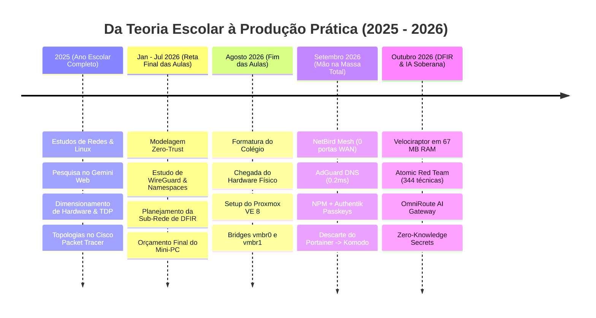

# 🏛️ Homelab Zero-Trust: Arquitetura & Infraestrutura

> **Autor:** Gabriel Santa Rosa Lessa  
> **Linha do Tempo:** 2025 – Presente  
> **Hypervisor:** Proxmox VE 8.x (Host Kernel Linux com cgroups v2)  
> **Princípio Central:** Perímetro fechado na WAN · Malha WireGuard P2P · Identidade Centralizada com WebAuthn

Bem-vindo à documentação técnica do meu laboratório de produção de engenharia e infraestrutura.

Este ambiente foi projetado para responder a um desafio real de engenharia:  
**Como manter 12 serviços críticos rodando 24/7 em alta disponibilidade com apenas 32 GB de memória RAM e um orçamento elétrico inferior a 25W, garantindo nível corporativo de segurança Zero-Trust?**

---

## ⚡ Destaques Rápidos de Engenharia

* **0 Portas Abertas na Internet:** Roteamento administrativo exclusivo via malha WireGuard P2P (NetBird).
* **0.2ms de Latência no DNS:** AdGuard Home com cache otimista e upstreams DoH redundantes.
* **Fim das Senhas:** Authentik SSO com Forward-Auth e chaves biométricas WebAuthn (FIDO2 Passkeys).
* **GitOps Leve em Rust:** Komodo Orchestrator substituindo gerenciadores pesados com footprint inferior a 20 MB por agente.
* **Governança de Memória:** Kernel Linux calibrado via `sysctl.conf` e cgroups v2 para evitar contenção de I/O e falhas OOM.

---

## 🧭 Linha do Tempo de Construção

