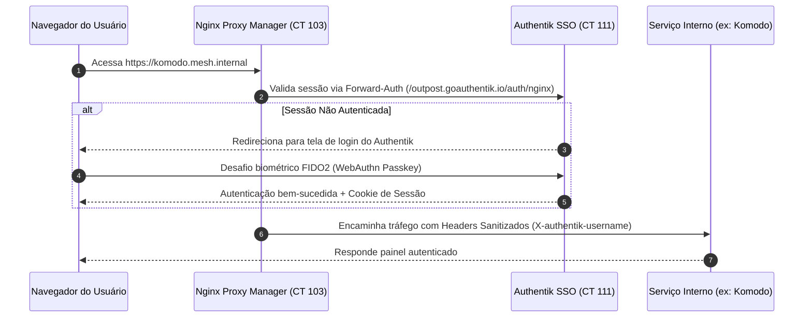

# 🛡️ Segurança & Hardening de Infraestrutura

A postura defensiva do laboratório foi desenhada seguindo as diretrizes do **NIST Cybersecurity Framework (CSF 2.0)** e práticas de **Zero-Trust Architecture (ZTA)**.

---

## 🔑 1. Authentik SSO + Forward-Auth com WebAuthn / Passkeys

Em vez de confiar em senhas fracas ou credenciais estáticas espalhadas por cada aplicação, a camada de acesso foi unificada:

### Vantagens de Segurança:
* **Fim das Forças-Brutas:** Zero formulários de login expostos diretamente; o Nginx bloqueia antes mesmo do tráfego tocar a aplicação alvo.
* **MFA Físico/Biométrico:** O Authentik exige toque de chave de segurança ou biometria (TouchID/Windows Hello).
* **Auditoria Centralizada:** Cada acesso gera evento auditável com geolocalização e identidade.

---

## 🌐 2. Wildcard TLS sem Exposição via DNS Challenge

Certificados SSL válidos (`Let's Encrypt`) são gerados automaticamente pelo Certbot integrado no Nginx Proxy Manager utilizando **DNS-01 Challenge**:
* Nenhuma porta 80 precisa ser aberta para verificação de HTTP.
* A validação ocorre criando um registro TXT temporário no provedor de DNS.
* Todos os serviços internos usam TLS criptografado ponto a ponto com cabeçalhos HSTS rígidos (`Strict-Transport-Security: max-age=31536000; includeSubDomains`).
