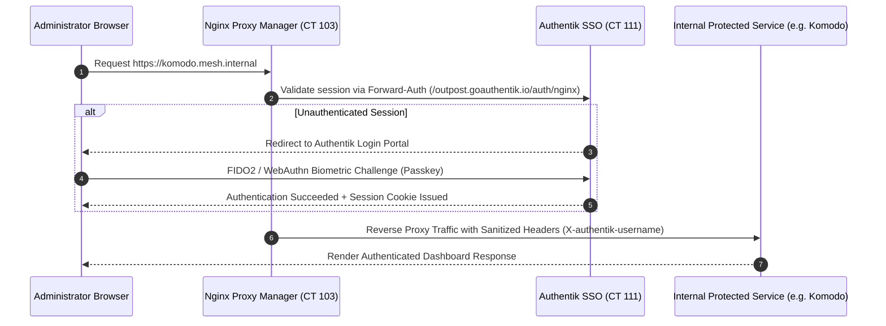

# 🛡️ Infrastructure Security & Hardening

The defensive posture of the homelab was architected strictly following the **NIST Cybersecurity Framework (CSF 2.0)** and **Zero-Trust Architecture (ZTA)** principles.

---

## 🔑 1. Authentik SSO + Forward-Auth with WebAuthn / Passkeys

Rather than relying on weak passwords or static credentials dispersed across individual application databases, the access tier is unified through centralized identity federation:

### Core Security Advantages:
* **Elimination of Password Brute-Force:** Zero login forms are exposed directly; Nginx rejects unauthenticated connections before traffic ever touches the target application.
* **Hardware Biometric MFA:** Authentik enforces physical security keys or hardware biometrics (TouchID, Windows Hello, YubiKey).
* **Centralized Audit Logging:** Every authentication and authorization event is recorded with geolocation and cryptographic identity.

---

## 🌐 2. Wildcard TLS Without Ingress Exposure (DNS-01 Challenge)

Valid Let's Encrypt SSL certificates are provisioned and renewed automatically via Certbot embedded inside Nginx Proxy Manager using the **DNS-01 Challenge**:
* Port 80 is never opened on the router for HTTP verification.
* Ownership validation executes via automated temporary TXT records written to the DNS provider API.
* All internal microservices communicate over encrypted TLS with strict HTTP Strict Transport Security (`Strict-Transport-Security: max-age=31536000; includeSubDomains`).
