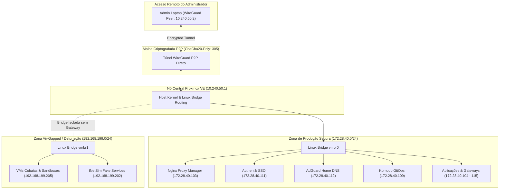

# 📐 Topologia de Redes & Zonas de Confiança

Nossa arquitetura de redes rejeita categoricamente o modelo tradicional de perímetro baseado em abertura de portas no roteador (*port-forwarding*).

---

## 🔒 A Arquitetura Zero-Trust Mesh

Em vez de expor portas 80/443 diretamente para a internet, todos os nós ingressam em uma **rede overlay WireGuard P2P gerenciada pelo NetBird**:

---

## 🌐 Mapeamento das Sub-Redes Sintéticas de Documentação

| Sub-Rede | Finalidade Técnica | Política de Roteamento |
| :--- | :--- | :--- |
| **`172.28.40.0/24`** | Serviços de Produção Homelab | Acessível apenas via túnel autenticado; zero exposição externa. |
| **`192.168.199.0/24`** | Sandbox Air-Gapped (`vmbr1`) | Isolamento total sem rota default; tráfego retido na camada 2. |
| **`10.240.50.0/24`** | Overlay WireGuard NetBird | Túneis ponto a ponto com autenticação criptográfica Ed25519. |

---

## ⚡ Resolução de Nomes com 0.2ms de Latência

O DNS interno é resolvido pelo **AdGuard Home (CT 112)** rodando em Go estático:
1. **Cache Otimista (`cache_optimistic: true`):** Responde instantaneamente requisições já consultadas com latência de 0.2ms e revalida a validade com o servidor upstream em background.
2. **Upstreams Seguros:** Consultas externas saem exclusivamente encapsuladas via **DNS-over-HTTPS (DoH)** com fallback para múltiplos provedores (`Quad9`, `Cloudflare`, `AdGuard`).
3. **Rewrites Locais:** Domínios internos apontam direto para o Nginx Proxy Manager (`172.28.40.103`), sem necessidade de consultar a internet pública.
