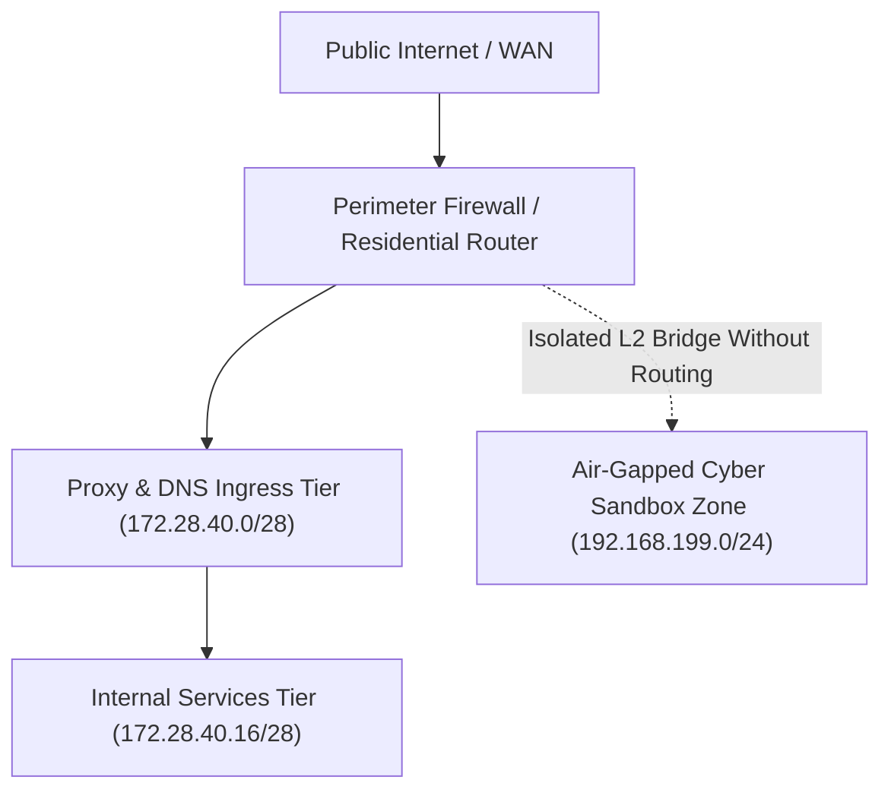

# Cisco Packet Tracer Topology Model & Subnet Allocation Matrix

**Date:** June 2025  
**Author:** Gabriel Santa Rosa Lessa  

## 1. Theoretical RFC 1918 Subnet Segmentation

Prior to racking physical hardware or connecting Ethernet cables, the network topology was modeled in Cisco Packet Tracer across 3 distinct trust zones:

### Documented Synthetic IP Allocation:
* **Primary Gateway / Hypervisor Host:** `172.28.40.1`
* **Nginx Reverse Proxy:** `172.28.40.10`
* **AdGuard Home DNS:** `172.28.40.12`
* **Central Identity Provider (Authentik SSO):** `172.28.40.15`
* **Isolated Cyber Training Bridge:** `192.168.199.0/24` (No default outbound route)
