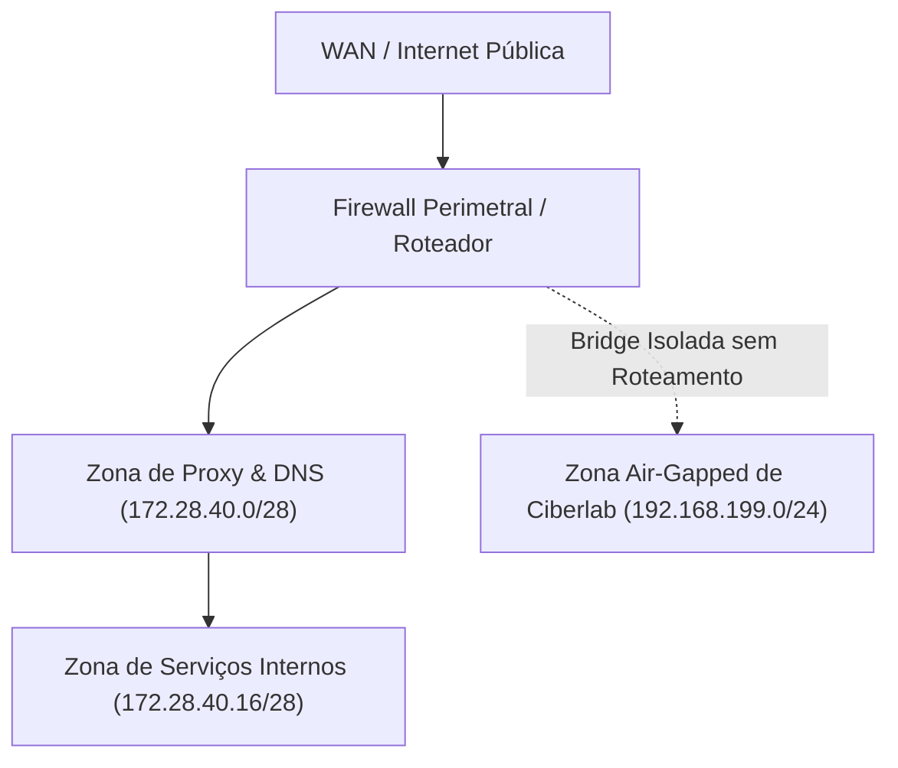

# Modelo de Topologia no Cisco Packet Tracer e Matriz de Sub-Redes

**Data:** Junho de 2025  
**Autor:** Gabriel Santa Rosa Lessa  

## 1. Segmentação Teórica de Sub-Redes RFC 1918

Antes de encostar em cabos ou hypervisors, a topologia foi desenhada no Cisco Packet Tracer com 3 zonas de confiança:

### Matriz de Endereçamento IP de Documentação:
* **Gateway Primário / Hypervisor:** `172.28.40.1`
* **Nginx Reverse Proxy:** `172.28.40.10`
* **AdGuard Home DNS:** `172.28.40.12`
* **Central de Identidade (Authentik SSO):** `172.28.40.15`
* **Rede de Treinamento Isolada:** `192.168.199.0/24` (Sem gateway de saída)
